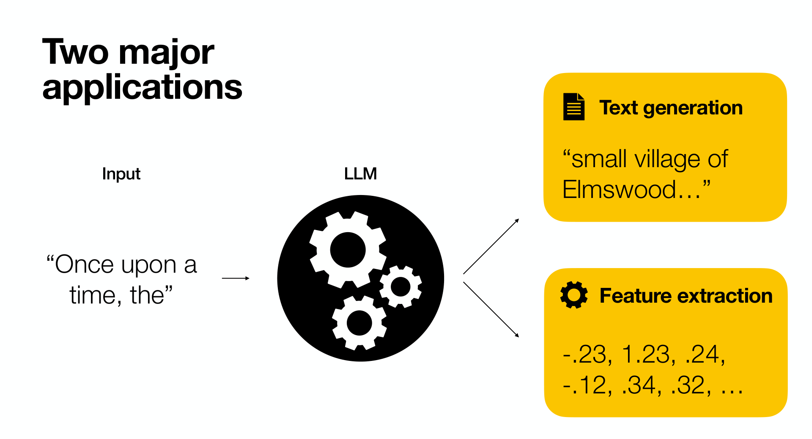
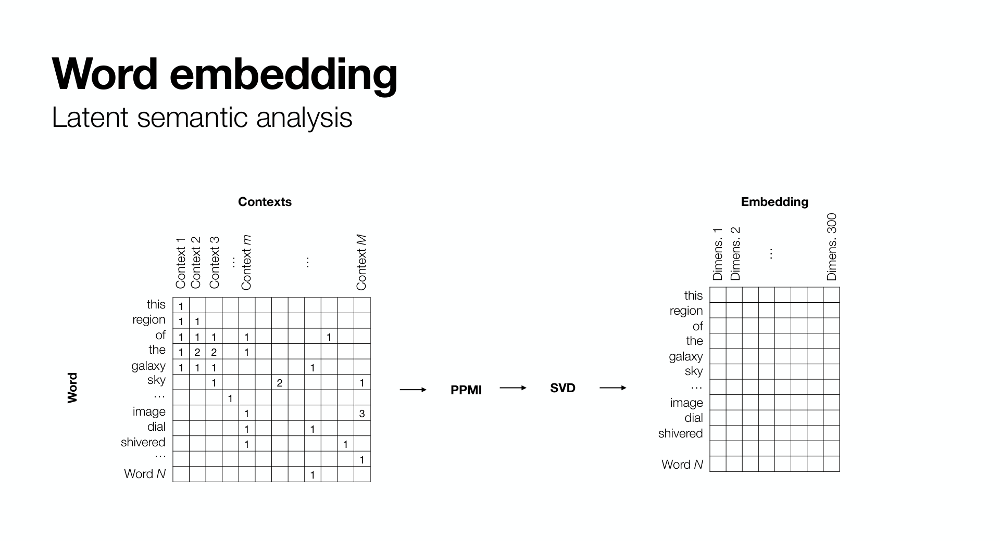
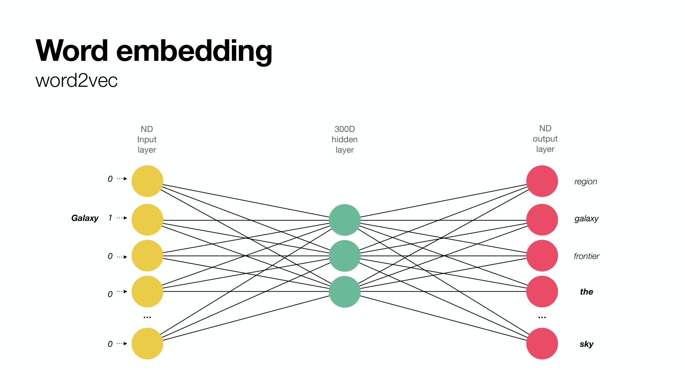
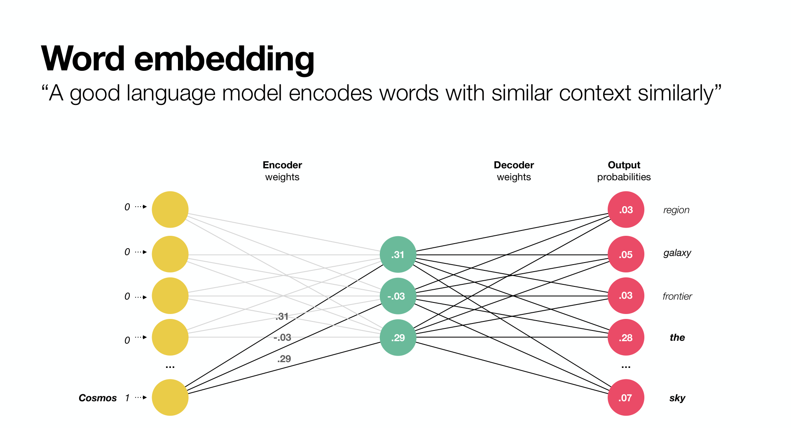
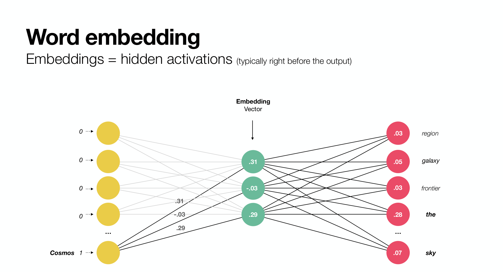
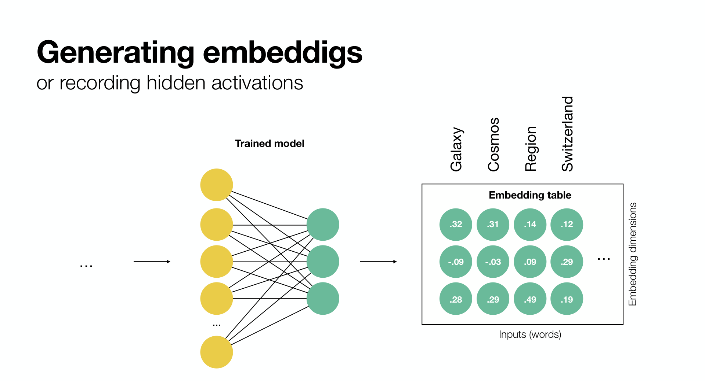
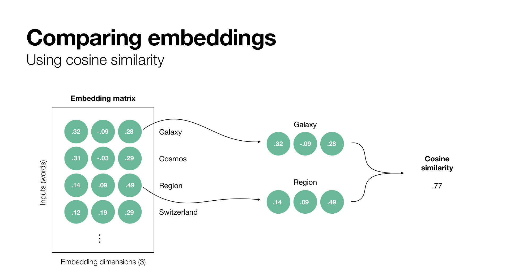
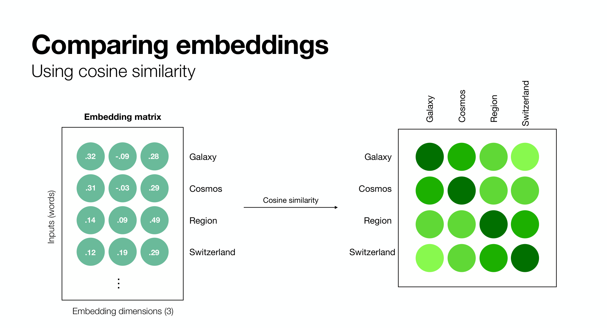

# 1. From words to vectors

A language model can do two very different things with a piece of text. It can *continue* it, which is what chatbots do, or it can *describe* it as a list of numbers. This tutorial is entirely about the second use. By the end of this chapter you will know what those numbers are, where they come from, and how to compare them.

## Two things a language model can give you



Every modern language model is a neural network that reads text and produces internal activations. Those activations can be decoded into the next word, which gives **text generation**. Or they can simply be read out as they are, which gives **feature extraction**: a fixed-length vector of numbers that summarises the input. That vector is the **embedding**.

Feature extraction is the quieter use, but for research it has three advantages. It is deterministic, it is cheap enough to run on a laptop over thousands of texts, and it hands you a numerical object that fits into the statistics you already know.

## Meaning from context


The idea behind every embedding model is older than neural networks. In the 1950s the linguist J. R. Firth proposed that the meaning of a word is given by the words that tend to occur around it. *Galaxy* and *cosmos* appear in the same sort of sentences, so they mean similar things. *Galaxy* and *Switzerland* rarely do. This is the **distributional hypothesis**, and it turns meaning into something you can count.

## Counting contexts: latent semantic analysis



The first practical implementation, in psychology no less, was **latent semantic analysis** (Landauer and Dumais, 1997). Take a large corpus, make a table with one row per word and one column per context (a document, or a window of neighbouring words), and count. Each row is already a crude vector for the word. Because the table is huge and sparse, it is re-weighted and compressed with a singular value decomposition to a few hundred dimensions. Those compressed rows are the embeddings.

## Predicting contexts: word2vec



In 2013, word2vec replaced counting with prediction. A tiny neural network takes a single word as a one-hot input and is trained to predict the words around it. The network is forced through a narrow hidden layer of, say, 300 units. To predict well, it must place words with similar contexts close together in that layer.



After training, the hidden layer is the embedding. Nobody told the network that *galaxy* and *cosmos* are related. It discovered it because the two words need the same output.

## An embedding is a hidden activation



This is the general recipe: train a network on some language task, then keep the activations of a hidden layer as the representation. How the network was trained decides how good those activations are as a measure of meaning, and there are three cases.

- **A by-product of another task.** word2vec predicts context words; a generative model predicts the next token. Their hidden activations carry meaning because the task cannot be solved otherwise, but nothing in the training asked the vectors to be comparable.
- **Encoder-only models.** BERT-style transformers have no output head for generating text. They are pretrained to fill in masked words, and every token gets a contextual vector that was never meant to produce output. Their hidden states are a better basis, but averaging them into one sentence vector still works only moderately.
- **Embedding models.** The models used in this book, such as `all-MiniLM-L6-v2`, are encoder-only transformers trained *for embeddings*: on hundreds of millions of sentence pairs, with a contrastive objective that pulls paraphrases together and pushes unrelated sentences apart. The vector is the output, and cosine similarity between vectors is what the training optimised.

The next chapter opens the encoder; the exercises use the third kind throughout.



Doing this for many inputs yields an **embedding table**: one row per input, one column per hidden dimension. That table is a perfectly ordinary data matrix. You can correlate its rows, cluster them, reduce them to two dimensions, or use them as predictors.

## Comparing vectors: cosine similarity



The individual numbers in an embedding are not interpretable. The *angle* between two embeddings is. **Cosine similarity** is the cosine of that angle:

$$\cos(\mathbf{a}, \mathbf{b}) = \frac{\mathbf{a} \cdot \mathbf{b}}{\lVert \mathbf{a} \rVert \, \lVert \mathbf{b} \rVert}$$

It ranges from 1 (same direction, same meaning) through 0 (unrelated) to -1 (opposite). Dividing by the vector lengths means a long, emphatic text and a short, plain text about the same topic still come out similar. It is also exactly the Pearson correlation of the two vectors when they have mean zero, which is a useful way to think about it.



Computing cosine similarity for every pair of inputs gives a symmetric **similarity matrix** with ones on the diagonal. For psychologists this object should look familiar: it has the same shape as an inter-item correlation matrix, and in Chapter 2 we will compare the two directly.

```{admonition} Check your understanding
:class: note
1. Why can two words that never appear in the same sentence still get similar embeddings?
2. In word2vec, what forces the hidden layer to encode meaning rather than, say, spelling?
3. Two texts have cosine similarity 0.9. Does that mean they say the same thing, or that they are about the same thing? What is the difference?
```

## Now the exercise

Open [the warm-up notebook](exercises/01_warmup) and press the rocket button at the top of that page to run it in Colab. The notebook has no outputs yet; they appear as you run the cells. Run the main blocks together, then take the tasks at your own pace.
