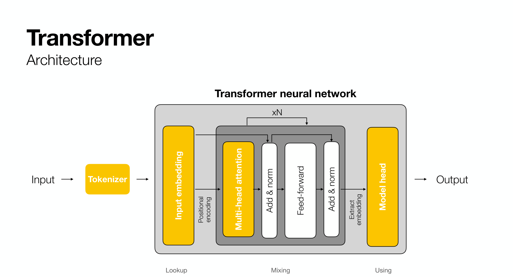
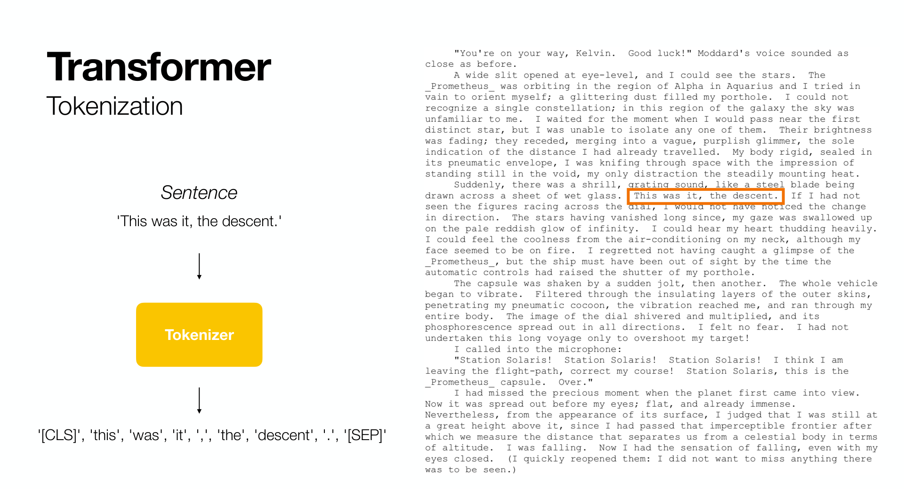
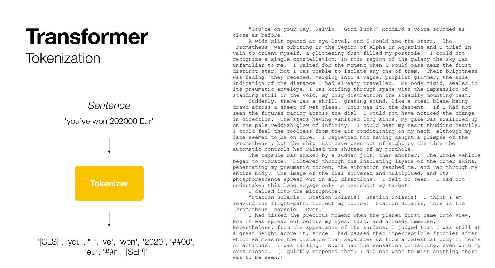
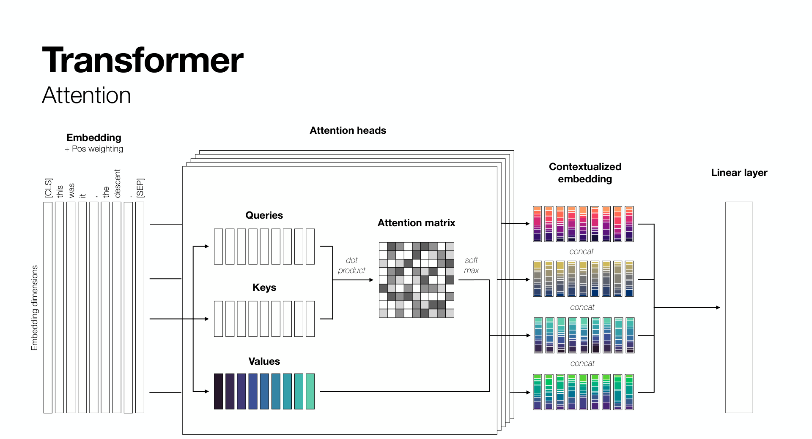
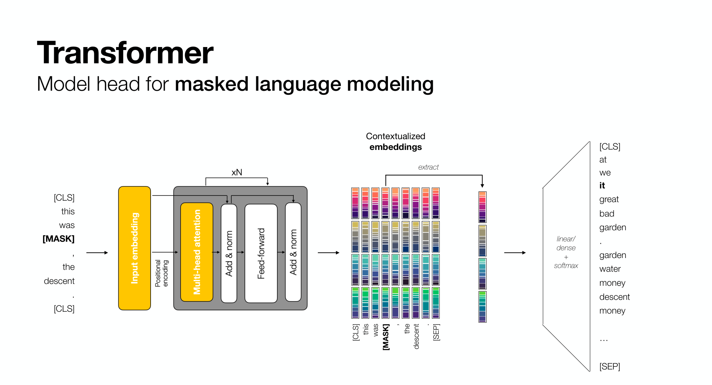
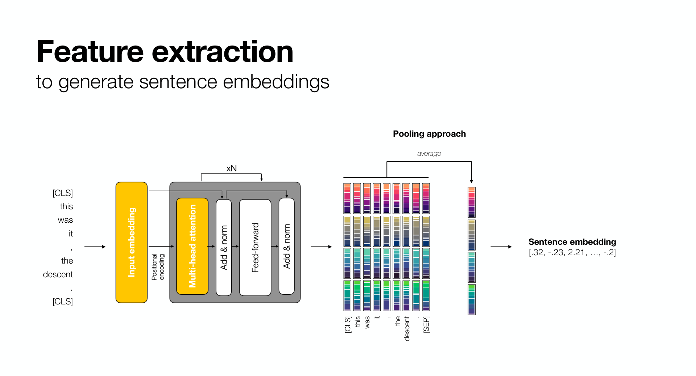
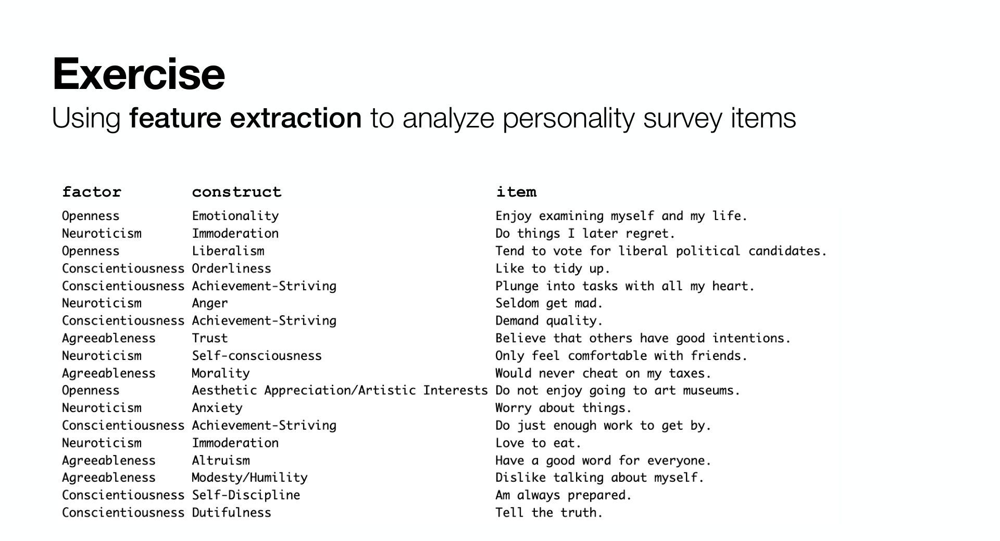

# 2. Sentence embeddings and psychological items

**Theory 10 min, exercise 35 min.**

Chapter 1 embedded single words with a shallow network. Real texts are sentences, and the model that embeds them is a **transformer**. This chapter explains just enough of the transformer to understand what a *sentence* embedding is, then puts it to work on something psychologists care about: whether a model's notion of similarity matches what people do when they answer a personality questionnaire.

## From words to sentences: the transformer



A transformer has three stages. A **tokenizer** splits the text into pieces and looks each one up in an embedding table, exactly like Chapter 1. A stack of **attention** blocks then mixes information between the pieces, so that the vector for each word comes to depend on the words around it. Finally a **model head** turns the mixed vectors into whatever the model was trained to output. For feature extraction we stop before the head and read out the vectors.

## Tokenization



The tokenizer does not work on whole words. It has a fixed vocabulary of about 30,000 **sub-word tokens** learned from frequency statistics. Common words are single tokens; rare words, numbers and typos are broken into pieces.



This matters in practice. A model never sees *"202000"*, it sees *2020* followed by *##00*. Questionnaire items with unusual words, abbreviations or domain jargon get fragmented, and the model has to reconstruct their meaning from the pieces.

## Attention: context changes the vector



Attention is what makes a transformer different from word2vec. For every token, the model computes how relevant every other token in the sentence is (the attention matrix), then updates the token's vector as a weighted mixture of the others. Several such **heads** run in parallel and the block is repeated many times. The result is a **contextualised embedding**: the vector for *bank* in *river bank* ends up different from the vector for *bank* in *bank account*. You do not need the details of queries, keys and values for this tutorial, only the consequence: a token's vector depends on its sentence.

## Training without labels: masked language modeling



Where does the training signal come from? Models in the BERT family are trained by **masked language modeling**: hide a random token, and ask the model to predict it from the rest of the sentence. Predicting *it* in *"This was [MASK], the descent"* requires understanding grammar and meaning, and the network learns both from raw text alone. No human labels are involved, which is why these models can be trained on billions of sentences.

## One vector per sentence: CLS or pooling

After the attention stack we have one vector per token, but we want one vector per sentence. There are two conventions.


The **CLS approach** keeps only the vector of the special `[CLS]` token at the start. Because attention lets that token look at everything, it can learn to summarise the sentence.



The **pooling approach** averages the vectors of all tokens. It is simpler, and it is what the `sentence-transformers` models you will use do. Those models have an extra training step: pairs of sentences known to be paraphrases are pushed together and unrelated pairs pushed apart, so that cosine similarity between pooled vectors becomes a good measure of meaning similarity (Reimers and Gurevych, 2019).

## Why psychologists should care: items are text



Every questionnaire item is a short text. Psychometrics has always treated the item text as something to be read by participants and otherwise ignored, with structure inferred only from response patterns. Embeddings let us treat the text itself as data.

Wulff and Mata (2025) embedded thousands of items from personality inventories and found that the semantic similarity between two items predicts the empirical correlation between them surprisingly well, that constructs with different names often sit in the same region of embedding space, and that constructs with the same name sometimes do not. They call this *taxonomic incommensurability*: the names on our scales are not a reliable guide to what they measure.

The exercise reproduces the core of that analysis on 300 items from the IPIP-NEO, with a general-purpose model first and a model fine-tuned on personality items second.

```{admonition} Check your understanding
:class: note
1. Why does the same word get different vectors in different sentences in a transformer but not in word2vec?
2. What is the training signal for masked language modeling, and why does it need no human annotation?
3. If you averaged the Chapter 1 word vectors of all words in a sentence, how would that differ from a sentence-transformer embedding?
```

## Now the exercise

Open [the item-pipeline notebook](exercises/02_items) and press the rocket button at the top of that page to run it in Colab. The notebook has no outputs yet; they appear as you run the cells. Run the main blocks together, then take the tasks at your own pace.
