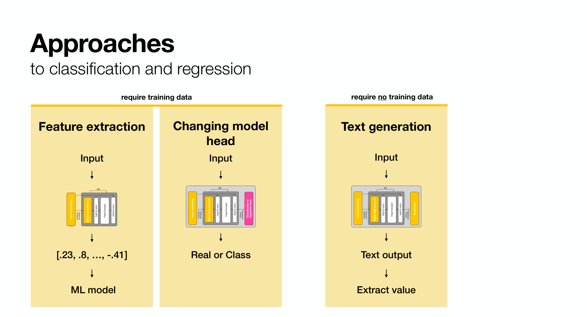
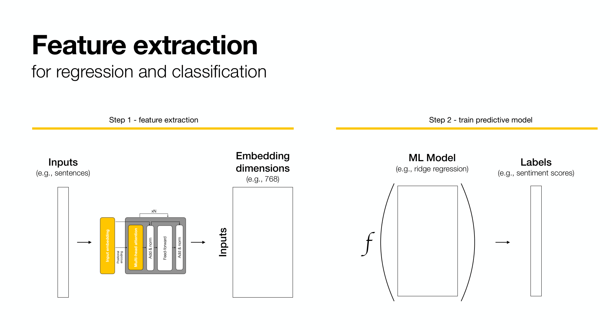
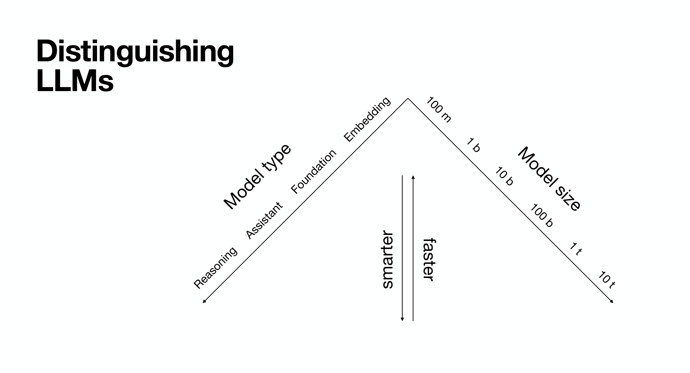
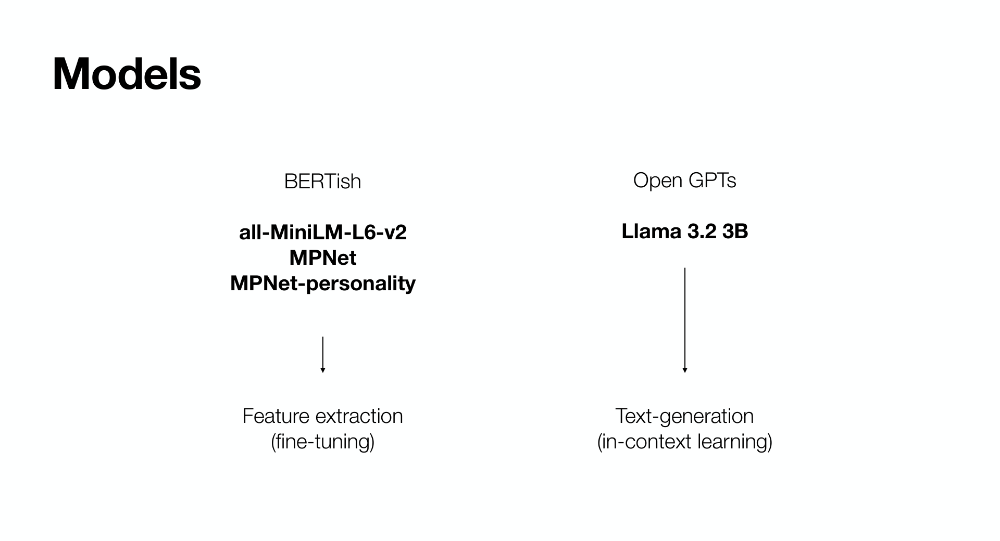
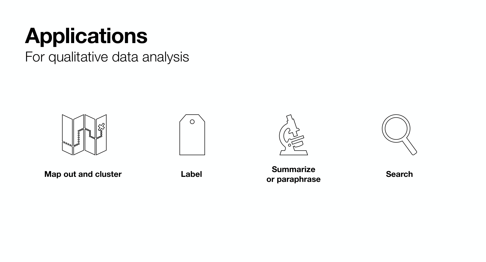
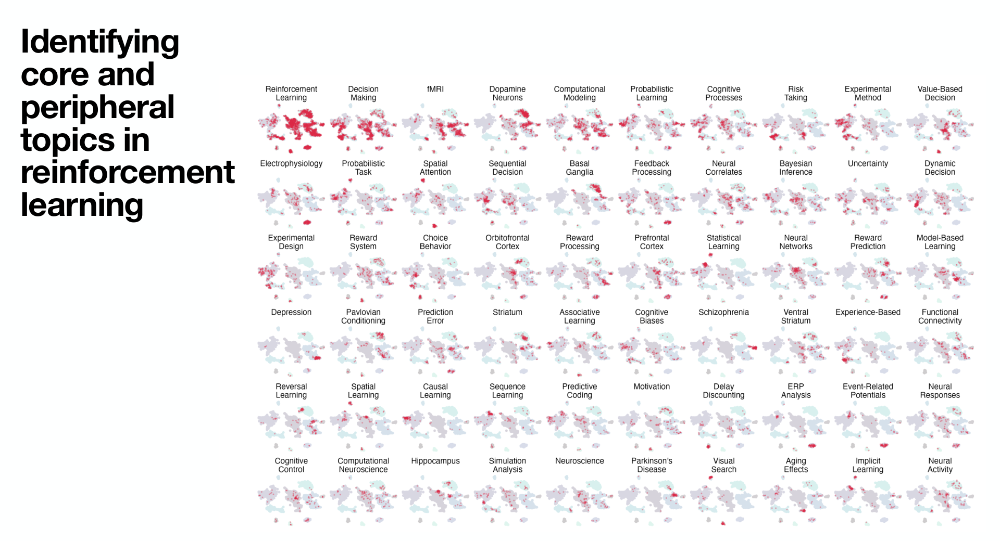
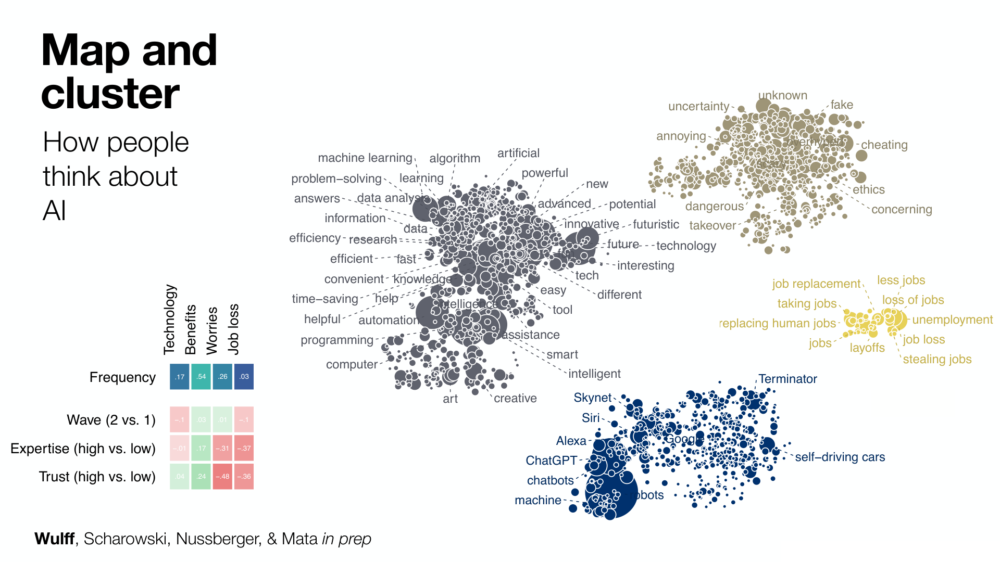
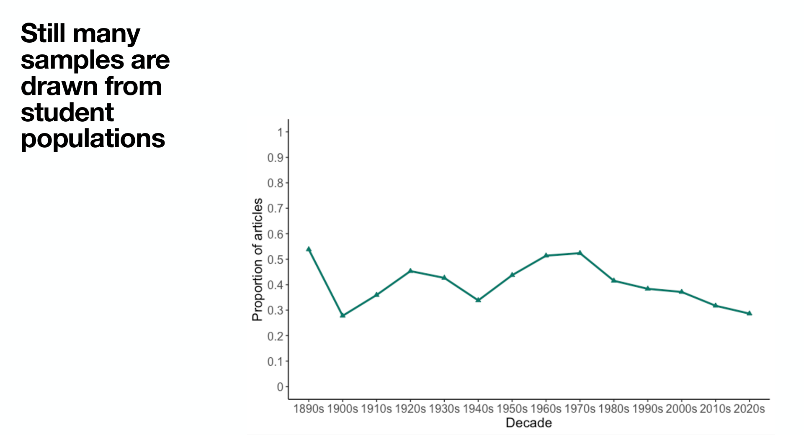

# 3. Beyond similarity: embeddings as features

So far we compared embeddings with each other. The most common use in applied research is different: embed your texts, then feed the vectors into an ordinary statistical model as predictors. The language model never sees your labels. It only provides a rich numerical description of each text, and the statistics you already know do the rest.

## Three ways to get a prediction out of a language model



Suppose you have texts and want a label or a score for each: a sentiment, a diagnosis category, a creativity rating. There are three routes.

1. **Feature extraction.** Embed the text, train any classical model on the vectors. The language model is frozen.
2. **Changing the model head.** Replace the model's output layer with a classifier and fine-tune part or all of the network on your labels. More powerful, more expensive, and the model can overfit a small dataset.
3. **Text generation.** Ask an instruction-tuned model, in words, to produce the label. No training data needed, but the output must be parsed, it is sensitive to the prompt, and it is hard to audit.

This chapter is about the first route. It is the cheapest, the most transparent, and surprisingly hard to beat when you have a few hundred labelled examples.

## Feature extraction in two steps



Step one turns N texts into an N by D matrix, with D equal to the embedding dimension (384 for the model we use, 768 for larger ones). Step two is any supervised method that takes a numeric matrix: ridge or lasso regression, logistic regression, random forests, gradient boosting. Because D is large relative to N in most psychology datasets, a **penalised** linear model is the sensible default, and that is what the exercise uses.

## Practical guide

Adapted from the course slide that compares the three approaches.

| | Feature extraction | Changing model head | Text generation |
|---|---|---|---|
| Training data needs | Moderate | Moderate to extreme | None to low |
| Computational needs | Low | Moderate to extreme | High to extreme |
| Biases | Moderate data and model bias | Strong data bias | Model bias |
| Performance | Very high (potentially) | Extremely high | Very high |
| Recommendation | Robust default with good training data | Top performance with good training data; prefer LoRA or adapters over full fine-tuning | Default without good training data |

## Which embedding model?



Embedding models are the small corner of the language model landscape: tens to hundreds of millions of parameters, not billions, which is why they run on a CPU. Within that corner there are hundreds of options. The [MTEB leaderboard](https://huggingface.co/spaces/mteb/leaderboard) benchmarks them across clustering, classification, retrieval and similarity tasks. For a project, start with a small general-purpose model, check whether a top-ranked model under 1B parameters helps, and only then consider fine-tuning on your own domain, as the personality model in Chapter 2 did.



```{admonition} Check your understanding
:class: note
1. Why must the scaler be fitted on the training set only, and what would go wrong if it were fitted on all the data?
2. You have 150 labelled therapy transcripts. Which of the three routes would you try first, and why?
3. What does a ridge penalty do when there are 384 predictors and 1,000 observations?
```

## Now the exercise

Open [the prediction notebook](exercises/03_features) and press the rocket button at the top of that page to run it in Colab. The notebook has no outputs yet; they appear as you run the cells. Run the main blocks together, then take the tasks at your own pace.

## Outlook: what embeddings enable in the field



Prediction is one use. Because embeddings turn any text into a point in a shared space, the same vectors support four families of analysis.

**Map and cluster.** Embed every abstract in a literature, reduce to two dimensions, and the field's structure becomes visible. Below, 5,692 reinforcement-learning articles, with the articles matching each topic highlighted.



The same works for participant-generated text. Here, free associations to the word *AI* cluster into technology, benefits, worries and job loss, and the clusters relate to expertise and trust.



**Label.** Chapter 3's exercise at scale: code open responses, classify documents into categories, score texts on a construct.

**Summarise or paraphrase.** Find the most central text in a cluster, or the pair of texts that differ most.

**Search.** Embed a query and find the nearest documents. Applied to 232,000 articles from the American Psychological Association, that makes meta-science questions answerable, such as how often samples are drawn from student populations.



## Where to go from here

- **Workflow summary.** Embed, then do what you already know: correlate, cluster, map, regress. The language model is a feature extractor, not an oracle.
- **Choosing a model.** The [MTEB leaderboard](https://huggingface.co/spaces/mteb/leaderboard). Small models under 1B parameters run on a laptop; the `sentence-transformers` tag means the code above works unchanged.
- **Domain fine-tuning.** `dwulff/mpnet-personality` shows what a few thousand labelled pairs buy you. The same recipe applies to any domain with pairwise similarity data.
- **R users.** The [embedR](https://github.com/dwulff/embedR) package wraps the same models and APIs from R.
- **Full course.** [LLM4BeSci](https://github.com/dwulff/LLM4BeSci_2025MetaRep) adds text generation, zero-shot classification with Llama, LoRA fine-tuning and information extraction.

See [References](references) for the reading list.
